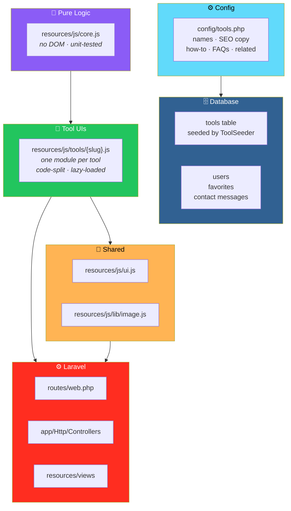

# 🧰 Toolora: Small Tools. Big Productivity.

<div align="center">


**An online tools site — small tools, big productivity.**

*15 launch tools · Search & SEO · Accounts & favorites · Runs in the browser*

[✨ Overview](#-overview) • [🚀 Install](#-install) • [🏗️ Architecture](#-architecture) • [🔐 Security](#-security-checklist) • [📊 Status](#-status-and-limitations)

</div>

---

## 📖 Overview

**Toolora** is a **Laravel 12 + Blade + Tailwind 4 + vanilla-JS** online tools site.

### Scope

> **Phase 1–3 plus basic accounts** of the master spec:
>
> - The **foundation**
> - The **15 launch tools**
> - **Search / SEO**
> - **Optional accounts with favorites**

> 📖 **See [Status and Limitations](#-status-and-limitations)** for exactly what is and is not built.

### How It Ships

> **It ships as an overlay applied to a fresh `laravel/laravel` 12 skeleton** — so you always get a **current, maintained framework and lockfile**.

### Core Idea

> **Tools run entirely in the browser.**
>
> The server stores accounts, favorites, and tool metadata — never the tool inputs.

---

## 🛠️ Requirements

| Requirement | Version |
|-------------|---------|
| **PHP** | 8.2+ — with `mbstring`, `pdo_mysql`, `xml`, `curl` |
| **Composer** | 2 |
| **Node** | 20+ |
| **Database** | MySQL 8 *(or MariaDB 10.6+)* |

---

## 🚀 Install

### 1. Unzip and Run the Installer

```bash
unzip toolora.zip && cd toolora
./install.sh toolora-app
cd toolora-app
```

**The installer will:**

- Create the Laravel app
- Apply Toolora
- Install npm dependencies
- Build assets

### 2. Create the Database

```sql
CREATE DATABASE toolora CHARACTER SET utf8mb4 COLLATE utf8mb4_unicode_ci;
CREATE USER 'toolora'@'localhost' IDENTIFIED BY 'a-strong-password';
GRANT SELECT, INSERT, UPDATE, DELETE, CREATE, ALTER, INDEX, DROP, REFERENCES ON toolora.* TO 'toolora'@'localhost';
```

**Then edit `.env`** with the database credentials.

### 3. Migrate and Seed

```bash
php artisan migrate --seed      # tables + categories + the 15 tools
php artisan serve               # http://localhost:8000
```

> 💡 **Use `npm run dev` for hot reload.**

### 🧪 Quick Trial Without MySQL

1. Set `DB_CONNECTION=sqlite` in `.env`
2. Remove the other `DB_*` lines
3. Run `touch database/database.sqlite`

---

## 🧪 Tests

### 🐘 PHP Tests

```bash
php artisan test
```

**Covers:**

- Pages
- Search
- SEO
- Auth
- Rate limiting
- Favorites
- Contact form
- Registry integrity

### 🟨 JavaScript Tests

```bash
node --test tests/js/core.test.js
```

**Covers tool logic:**

- JSON
- Text
- Base64
- URL
- Diff
- Percentage
- Passwords
- UUID
- Timestamps
- Regex
- Meta tags
- QR codes

---

## 🏗️ Architecture

### System Overview



### 📂 File Layout

| Piece | Location |
|-------|----------|
| **Tool registry** — names, SEO copy, how-to, FAQs, related | `config/tools.php`, copied to the DB by `ToolSeeder` |
| **Pure tool logic** — no DOM, unit-tested | `resources/js/core.js` |
| **Tool UIs** — one module per slug, code-split and loaded only on that page | `resources/js/tools/{slug}.js` |
| **Shared UI helpers / image pipeline** | `resources/js/ui.js`, `resources/js/lib/image.js` |
| **Routes / controllers** | `routes/web.php`, `app/Http/Controllers` |
| **Layout and pages** | `resources/views` |

### ➕ Adding a Tool *(No Other Code Changes)*

**Three steps:**

1. **Add an entry** to `config/tools.php`
2. **Create** `resources/js/tools/{slug}.js` exporting `default function mount(root)`
3. **Run** `php artisan db:seed --class=ToolSeeder`

> ✅ **`RegistryTest` fails if a registry entry has no module or content.**
>
> **Existing rows keep their `status`** — to hide a tool, set `status` to `draft` or `archived` in the DB.

### Design Principles

<div align="center">

| Principle | Implementation |
|-----------|---------------|
| **🔒 Browser-first** | Tools run entirely in the browser — the server never processes user files or URLs |
| **🧠 Pure logic, tested** | `core.js` has no DOM — every tool's logic is unit-tested in Node |
| **🎨 Code-split by slug** | Each tool's UI is loaded **only on that page** — no wasted bytes |
| **📊 Registry is the source of truth** | Names, SEO copy, how-to, FAQs, and related tools all live in `config/tools.php` |
| **🚫 Registry integrity enforced** | `RegistryTest` fails if a tool has no module or content |
| **🔧 Adding a tool is three steps** | Entry + module + seed — no routing or controller changes |
| **🛡️ Defense in depth** | CSRF · validation · escaping · rate limiting · security headers · escaped LIKE · Eloquent bindings |
| **🔐 Privacy by architecture** | The DB stores only users, favorites, metadata, and contact messages — **tool inputs are never stored** |
| **📈 SEO-ready** | Sitemap, robots.txt, canonical, Open Graph, JSON-LD, breadcrumbs |

</div>

---

## 🚢 Production Deployment

### 1. Build

```bash
composer install --no-dev --optimize-autoloader
npm ci && npm run build
```

### 2. Configure `.env`

```env
APP_ENV=production
APP_DEBUG=false
APP_URL=https://yourdomain
SESSION_SECURE_COOKIE=true
# + real DB credentials (least-privilege user, see SQL above)
```

### 3. Generate Keys and Cache

```bash
php artisan key:generate --force    # once
php artisan migrate --force --seed
php artisan config:cache route:cache view:cache event:cache
```

### 4. Serve

- **Point the web root at `public/`**
- **Nginx:** `try_files $uri $uri/ /index.php?$query_string;` — **and deny dotfiles**
- **Serve over HTTPS only** — the app forces HTTPS URLs in production

### 5. Queues

**Run `php artisan queue:work` under a supervisor only once you add queued work.**

> 💡 **None is needed yet.**

### 6. Backups

- **Nightly:** `mysqldump --single-transaction toolora | gzip` stored **off-server**
- **Test a restore monthly**
- **The DB holds only:** users, favorites, tool metadata, and contact messages
- **Tool inputs are never stored**

### 7. SEO

- **Submit `https://yourdomain/sitemap.xml`** in Google Search Console
- **`robots.txt` is generated** and disallows `/dashboard`, `/auth/`, and filtered/search URLs

---

## 🔐 Security Checklist

<div align="center">

| Protection | Status |
|-----------|:------:|
| **CSRF on all forms** *(Laravel)*, server-side validation, Blade output escaping, no `innerHTML` in tool code | ✅ |
| **Passwords hashed** *(bcrypt via model cast)*, min length **10**, session regeneration on login/logout | ✅ |
| **Rate limiting** on login, registration, and contact (`throttle`), **covered by a test** | ✅ |
| **Auth middleware** on account pages; **favorites scoped to the signed-in user** | ✅ |
| **Security headers** — nosniff, frame, referrer, permissions, HSTS on HTTPS | ✅ |
| **No server-side processing** of user files or URLs — **no upload, SSRF, or path-traversal surface exists yet** | ✅ |
| **LIKE wildcards escaped** in search; **Eloquent bindings** throughout | ✅ |
| **Secrets only in `.env`**, which is git-ignored by Laravel | ✅ |
| **Add a Content-Security-Policy** once you finalize third-party scripts *(ads)* — **start in report-only mode** | ⏳ |
| **Email verification, password reset, account deletion** *(see below)* | ⏳ |
| **Before taking payments or issuing API keys:** webhook signature verification, hashed key storage, quotas, audit log | ⏳ |

</div>

---

## 🔒 Privacy and Data Retention

### What Runs Where

> **Tools run entirely in the browser.**

### What the Server Stores

- **Account** — name, email, password hash
- **Favorites**
- **Contact messages**
- **Standard web-server logs**

### Suggested Retention

| Data | Retention |
|------|-----------|
| **Contact messages** | Delete after **12 months** |
| **Server logs** | Rotate at **30 days** |
| **User data** | Delete on request |

> 💡 **`privacy.blade.php` describes the current behavior accurately** — **update it before adding analytics or ads**.

---

## 💰 Monetization Guidance *(Not Yet Implemented)*

### 📢 Ads

- **Apply to Google AdSense** only **after the site has real content and traffic**
- **Approval is not guaranteed**
- **Then add a CSP-compatible, configurable ad component** outside the tool workspace
- **Add a consent banner** where required *(EU/UK)*
- **Update the privacy page**

### 💳 Payments

- **Pick a provider that supports your legal entity and country:**
  - **Stripe** — where available
  - **Paddle** or **Lemon Squeezy** — as merchant-of-record
- **Grant premium only from signature-verified webhooks**
- **Never trust client-side success pages**
- **Treat $5.99/mo and $49.99/yr as hypotheses to test**

### 🔌 API

> **Do not expose until keys are hashed, quotas enforced, and abuse controls exist.**
>
> **No API endpoints exist in this version.**

---

## 📊 Status and Limitations

### ✅ Verified in the Build Environment

<div align="center">

| Verification | Details |
|-------------|---------|
| **Tool logic** | **14 Node tests** |
| **Every tool module** | Bundles and mounts in **jsdom** |
| **Interaction checks** | **8 tools** |
| **QR payloads** | Decode with an **independent decoder** *(jsQR)* |
| **Tailwind stylesheet** | Compiles |
| **PHP files** | All parse |

</div>

### ⚠️ Not Verified Here

> **The Laravel application itself** *(PHPUnit, migrations, Blade rendering)* **and real-browser behavior** *(image Canvas encoding, downloads, clipboard)*.
>
> **The sandbox could not reach Packagist and has no PHP.**
>
> **Run the two test commands above after installing** — and expect to fix small issues.

### 📋 Status Table

<div align="center">

| Area | Status |
|------|:------:|
| **15 launch tools** — JSON, image compress/convert, QR, word counter, case, Base64, URL, UUID, password, percentage, meta tags, regex, diff, timestamp | ✅ **Implemented** |
| **Homepage, /tools, categories, search, sort, related tools, sitemap, robots, canonical, OG, JSON-LD, breadcrumbs** | ✅ **Implemented** |
| **Register / login / logout, favorites, contact form, About / Privacy / Terms** | ✅ **Implemented** |
| **Light/dark theme, sticky header, mobile menu, accessible skip link** | ✅ **Implemented** |
| **Remaining ~100 tools** — PDF, other image/dev/text/SEO/everyday tools | ❌ **Not built** |
| **Email verification, password reset, profile edit, account deletion, preferences** | ❌ **Not built** |
| **Pricing page, subscriptions, payments, premium gating, ads** | ❌ **Not built** |
| **API keys / quotas / API docs** | ❌ **Not built** |
| **Admin dashboard, blog, analytics, usage events, history** | ❌ **Not built** |
| **Image tools** — JPEG/PNG/WebP only, **no batch ZIP**, **EXIF is stripped** | ⚠️ **Limitation** |
| **`/dashboard/*` routes** — **not** `/dashboard/history` or `/dashboard/api` | ⚠️ **Limitation** |
| **Review `terms` and `privacy` text with a lawyer before launch** | ⚠️ **Required** |

</div>

> ⚠️ **Nothing here guarantees traffic or revenue** — both depend on **content quality, distribution, and demand**.

---

## 🗺️ Roadmap

### ✅ Current — Phase 1–3 + Accounts

- [x] Laravel 12 + Blade + Tailwind 4 + vanilla-JS foundation
- [x] Ships as an overlay on a fresh Laravel skeleton
- [x] One-step installer script
- [x] 15 launch tools — JSON, image compress/convert, QR, word counter, case, Base64, URL, UUID, password, percentage, meta tags, regex, diff, timestamp
- [x] Pure tool logic in `core.js` with 14 Node tests
- [x] Code-split tool UIs, one module per slug
- [x] Registry-driven tool metadata in `config/tools.php`
- [x] Registry integrity enforced by `RegistryTest`
- [x] Homepage, `/tools`, categories, search, sort, related tools
- [x] Sitemap, robots.txt, canonical, Open Graph, JSON-LD, breadcrumbs
- [x] Register / login / logout
- [x] Favorites scoped to the signed-in user
- [x] Contact form
- [x] About, Privacy, Terms pages
- [x] Light/dark theme, sticky header, mobile menu, accessible skip link
- [x] CSRF, validation, escaping, rate limiting, security headers
- [x] Escaped LIKE wildcards in search
- [x] bcrypt password hashing with 10-character minimum
- [x] Session regeneration on login/logout
- [x] No server-side processing of user files or URLs
- [x] PHPUnit and Node test suites
- [x] Production deployment guide with least-privilege SQL

### 🔜 Future Ideas

- [ ] **~100 more tools** — PDF, other image/dev/text/SEO/everyday tools
- [ ] **Email verification, password reset, profile edit, account deletion, preferences**
- [ ] **Pricing page, subscriptions, payments, premium gating**
- [ ] **Ads** — AdSense or CSP-compatible alternative with consent banner
- [ ] **API keys, quotas, API docs** — only after hashing, quotas, and abuse controls
- [ ] **Admin dashboard**
- [ ] **Blog** — content marketing for SEO
- [ ] **Analytics and usage events**
- [ ] **Tool history** per user
- [ ] **Content-Security-Policy** in report-only mode, then enforced

---

## 🤝 Contributing

Contributions are welcome. Please:

1. Fork the repository
2. **Keep tool logic pure** — `core.js` must have no DOM dependencies
3. **Add tools through the registry** — `config/tools.php` plus `resources/js/tools/{slug}.js`
4. **Preserve registry integrity** — `RegistryTest` must pass
5. **Keep tools browser-first** — never add server-side processing of user files or URLs
6. **Preserve the security checklist** — CSRF, validation, escaping, rate limiting, scoped favorites
7. **Update `privacy.blade.php`** if you add analytics, ads, or any data collection
8. Submit a Pull Request

### Guidelines

- **Never store tool inputs** — the privacy promise depends on it
- **Never use `innerHTML`** in tool code — use DOM APIs
- **Never trust client-side success** for payments — webhooks only
- **Never expose an API** without hashed keys, quotas, and abuse controls
- **Never claim a feature is built** when the status table says otherwise

---

## 📜 License

MIT — see [LICENSE](LICENSE) for details.

---

## 🙏 Acknowledgments

- **Laravel** — for a framework that makes the boring parts boring
- **Tailwind CSS** — for styling that stays in the markup
- **jsQR** — for independent QR verification in the test suite
- **Every developer who's ever needed a quick tool and found a sketchy one** — this one's for you

---

<div align="center">

### 🧰 SMALL TOOLS. BIG PRODUCTIVITY.

**15 launch tools. Search & SEO. Accounts & favorites.**

**Tools run entirely in the browser. No tool input ever stored.**

<br>

> ⚠️ **Verified: tool logic, bundling, QR decoding, stylesheet compilation.**
>
> **Not verified: the Laravel app itself and real-browser behavior.**

<br>

⭐ If Toolora helped you, consider giving it a star.

<br>

[⬆ Back to Top](#️-toolora-small-tools-big-productivity)

</div>
